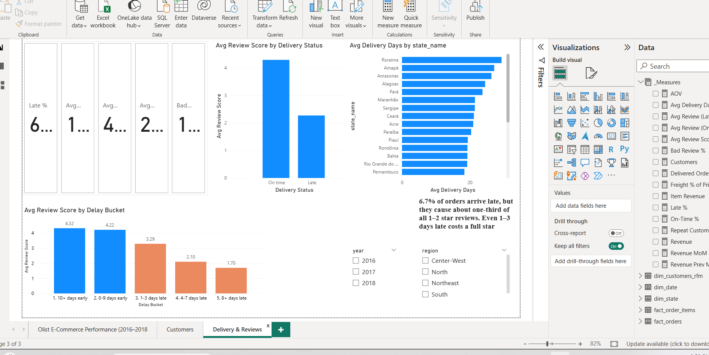

# Olist E-Commerce Analysis: Why do customers leave bad reviews?

End-to-end data analysis of **99,441 real orders** from Olist, a Brazilian online marketplace (2016–2018), using **Excel, SQL (PostgreSQL), Python and Power BI**.

🔗 **Live project page:** [[olist-analysis-rabin.netlify.app](https://olist-analysis-rabin.netlify.app/)](olist-analysis-rabin.netlify.app)
📄 **Dashboard PDF:** [powerbi/olist_dashboard.pdf](powerbi/olist_dashboard.pdf)



---

## Business questions
1. How are revenue and orders trending, and which categories and states drive them?
2. Do customers come back after their first purchase?
3. Who are the most valuable customers?
4. **Does late delivery hurt review scores, and by how much?**

## Key findings

| Metric | Value |
|---|---|
| Orders analysed | 99,441 |
| Product revenue (delivered orders) | R$13.2M |
| Unique customers | 93,358 |
| Customers who ordered again | **3.0%** |
| Orders delivered late | **6.7%** |

1. **Late deliveries drive a third of bad reviews.** Only 6.7% of orders arrived late, but they produced about 32% of all 1–2 star reviews. Late orders averaged **2.27 stars vs 4.29** on time, and 62% of late orders got a bad review (Mann-Whitney U test, p < 0.001).
2. **Even a small delay costs a full star.** Scores fall steadily with delay:

   | Delivery timing | Orders | Avg review |
   |---|---:|---:|
   | 10+ days early | 61,523 | 4.32 |
   | 0–9 days early | 27,920 | 4.22 |
   | 1–3 days late | 1,852 | 3.29 |
   | 4–7 days late | 1,748 | 2.10 |
   | 8+ days late | 2,781 | 1.70 |

3. **Delivery estimates are overly cautious.** 64% of orders arrived 10+ days before the estimated date, yet arriving very early scores about the same as arriving on time.
4. **Customers rarely return.** Only 3.0% ordered twice, and monthly cohort retention stays below 1%.
5. **Revenue depends on one-time, high-value buyers.** The "Promising" and "At risk" RFM segments are 30% of customers but 58% of revenue.

## Recommendations
- Fix the worst delays first: orders 8+ days late average 1.7 stars. Target the slowest states and sellers.
- Set realistic delivery estimates per region instead of padding them for everyone.
- Notify customers proactively when an order will miss its estimated date.
- Encourage second purchases from satisfied, high-value one-time buyers.

---

## Tools and workflow

| Step | Tool | What I did |
|---|---|---|
| 1 | **Excel** | Imported CSVs with Power Query, checked duplicates and blanks per table, built first pivot tables |
| 2 | **PostgreSQL** | Loaded 9 related tables (1.5M+ rows), added keys, built cleaning views, answered business questions with CTEs and window functions |
| 3 | **Python** | Statistical test (Mann-Whitney U, Welch t-test, Cohen's d), RFM segmentation, cohort retention, export of a star schema |
| 4 | **Power BI** | Star-schema model with a date table, 17 DAX measures, 3-page interactive dashboard |

## Repository structure
```
├── excel/        01_excel_exploration.xlsx   data quality checks and pivots
├── sql/
│   ├── 00_reset_tables.sql      (drops all tables; only for starting over)
│   ├── 01_create_tables.sql     table definitions
│   ├── 02_load_data.sql         \copy commands to load the CSVs
│   ├── 03_validate_load.sql     row counts, duplicates, foreign keys
│   ├── 04_cleaning_views.sql    clean views (one review per order, English categories, delay columns)
│   └── 05_analysis_queries.sql  business questions
├── python/       olist_analysis.ipynb        statistics, RFM, cohorts, export
├── powerbi/      olist_dashboard.pbix / .pdf, dax_measures.md, dim_state.csv
├── images/       dashboard and chart screenshots
└── docs/         project web page (hosted on Netlify)
```

## Data
[Brazilian E-Commerce Public Dataset by Olist](https://www.kaggle.com/datasets/olistbr/brazilian-ecommerce) on Kaggle (CC BY-NC-SA 4.0). The raw CSVs are not included in this repository because of their size; download them from Kaggle.

### Data quality issues handled
- Duplicate review IDs and orders with several reviews → kept the latest review per order
- Products with no category, and categories missing from the translation table → labelled `unknown` or kept the Portuguese name
- Orders with no delivery date (mostly canceled or still shipping) → excluded from delivery metrics
- ~1M geolocation rows with many duplicates → averaged to one point per zip code
- Incomplete first and last months → excluded from trend analysis

## How to reproduce
1. Download the dataset from Kaggle.
2. Create a PostgreSQL database named `olist` and run `sql/01_create_tables.sql`.
3. Edit the folder path in `sql/02_load_data.sql`, then run it in the psql tool.
4. Run `sql/03_validate_load.sql`, then `sql/04_cleaning_views.sql`.
5. Create a `.env` file in the project root with `PG_PASSWORD=your_password`, then run `python/olist_analysis.ipynb`. This writes the clean CSVs to `data/clean/`.
6. Open `powerbi/olist_dashboard.pbix` and refresh the data source paths if needed.

---
**Author:** Your Name · [LinkedIn](https://www.linkedin.com/in/YOUR-PROFILE)
